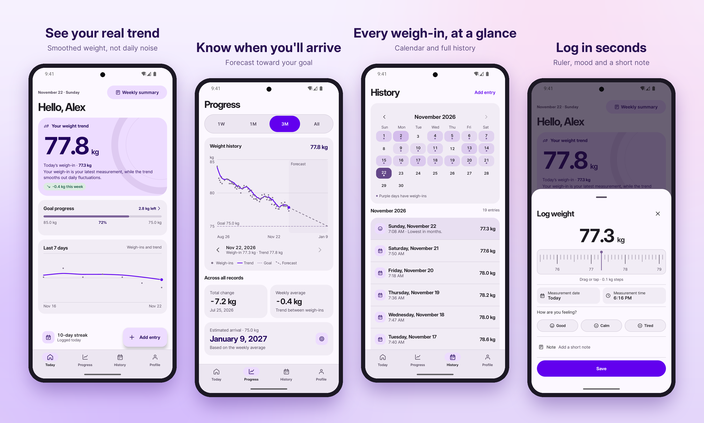
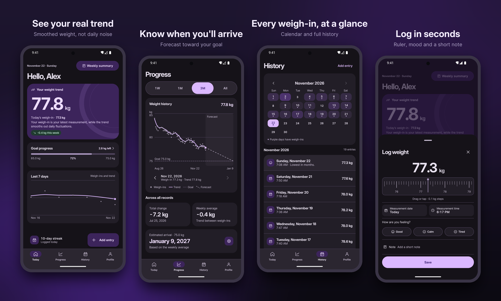

# Kilo Takibi

A simple, private weight tracker for Android. Log daily weigh-ins, see your trend on a date-based chart and keep notes, all stored on your device.

[](https://play.google.com/store/apps/details?id=com.yusufcanmercan.weight_track_app)

## Features

- Daily weigh-ins with optional mood and notes, edit and delete
- Smoothed weight trend and date-based progress chart
- Goal weight with an estimated arrival date, BMI and milestones
- Calendar and full history
- Weekly summary you can share, and a daily reminder at a time you choose
- Home screen widget
- CSV export and import
- English and Turkish, light and dark theme

No account, ads or analytics, and no internet permission; see the [privacy policy](https://cusufcan.github.io/kilo-takibi/privacy.html).

## Screenshots




## Stack

- Kotlin, Jetpack Compose (Material 3)
- MVVM with unidirectional data flow
- Room + Kotlin Flow, DataStore
- Hilt (KSP), Navigation Compose with type-safe routes
- JUnit, coroutines-test and Compose UI tests
- GitHub Actions CI

## Build

Requirements: JDK 17 and the Android SDK (min SDK 25, target SDK 37).

```bash
./gradlew assembleDebug        # debug APK
./gradlew test                 # unit tests
./gradlew lintDebug            # lint
./gradlew connectedAndroidTest # UI tests (emulator or device)
```

## Credits

Built in collaboration with AI coding agents such as Claude and Codex.

## License

Copyright © 2026 Yusuf Can Mercan. All rights reserved.

The source code is published for viewing only. Copying, modifying, redistributing or using it for commercial purposes requires written permission. See [LICENSE](LICENSE).

## Contact

- LinkedIn: [linkedin.com/in/cusufcan](https://linkedin.com/in/cusufcan)
- Email: [yusufcanmercan.info@gmail.com](mailto:yusufcanmercan.info@gmail.com)
